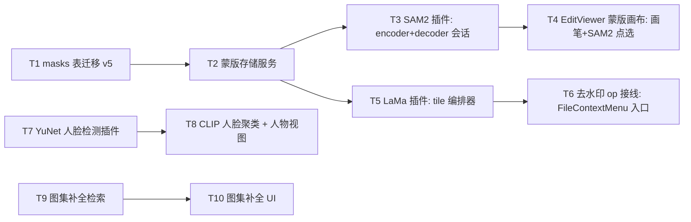

# 实施计划 Phase 10 — 蒙版体系 / SAM2 交互分割 / LaMa 去水印 / 人脸 / 图集补全

> 本文把 [ai-crawler-direction-2026-q4.md](./ai-crawler-direction-2026-q4.md) §14 Phase 10 既定范围落成任务级实施规格。
> **前序基座**：Phase 9 已交付 [EditsService](../../src/main/services/edits-service.ts) / [JobRunner](../../src/main/services/job-runner.ts) / MemoryMonitor / ModelManager / CLIP 索引（[ai-wiring.ts](../../src/main/services/ai/ai-wiring.ts)、[vector-index-service.ts](../../src/main/services/vectors/vector-index-service.ts)）。
> **本轮边界**：只产出计划文档；T1-T10 的代码实现属下一批准轮。不实现 SAM2/LaMa 推理本身，不做 Phase 11 扩散（D2）。
> **纪律**：一切 op 输出新文件走 EditsService 版本链，**原图绝对不改**（§8.1）；大图强制分块 + 单次分辨率 ≤4K + 用完 unload（§7.4 R7 水位红线）；量化前必须在模型自己的真实输入上跑质量对照。

---

## 1. 范围与 Non-Goals

**纳入**（方向文档 §14 Phase 10 既定，不重新发明）：
1. 蒙版体系（存储 + 三来源之①手工画笔 ②SAM2 点选）
2. SAM2 交互式分割（encoder 一次 / decoder 多次）
3. LaMa 去水印（tile 编排器 + 羽化回贴）
4. 单图交互式编辑器 UI（EditViewer）
5. 人脸检测 / 识别特征 / 聚类 + 人物视图
6. 图集缺图补全（检索式，12.7）

**不纳入**：
- D2 扩散类（Phase 11，前置 R6/R8 未完成不得开工）
- 蒙版三来源之③自动水印检测（方向文档标 Phase 8-9，实际未做，Phase 10 不补此历史项，登记为遗留）
- SAM2/LaMa 推理代码实现（本轮仅计划）

**直接继承的既定决策**（不得重开）：
- §8.1 原图不改，op 输出新文件走版本链；§8.2 `edits` 表已建（master.db 迁移 v2），`parent_edit_id` 构成树
- §8.4 SAM2 CPU 实测 enc 2.3s / dec 11ms（i9 桌面，OpenCV DNN 基准）
- §8.5 蒙版表 schema：`masks(library_id, image_id, source, data PNG, created_at)`；§8.6 蒙版体系早于扩散

---

## 2. 模型选型决策记录

| 项 | 决策 | 理由（含外网数据锚点） |
|---|---|---|
| 交互分割 | **SAM2.1 hiera-tiny**，encoder 128MB fp32 ONNX（HF `vietanhdev/segment-anything-2-onnx-models` 或 `CUSL-Jeremy/segment-anything-2.1-onnx-models`）+ decoder 19.7MB | enc 2.3s + dec 11ms 的架构匹配交互；tiny 是最小可用档（38.9M 参数），可平滑升 base_plus（324MB）不换 API |
| 交互延迟预算 | encoder ≤3s（含 4K→1024 降采样预处理）+ decoder ≤100ms/点击（11ms 实测 + 10× 余量） | enc 期显进度遮罩；点击响应须亚秒级否则失去「交互」意义 |
| 去水印/局部重绘 | **LaMa big-lama ONNX fp32**（HF `IsGarrido/LaMa-ONNX`，`lama_fp32.onnx` 198MB，opset 17，固定 512×512 输入） | FFC 全局感受野对大洞结构重建强（ClearPix 实测大洞 +11.6dB）；**fp16/int8 破坏 mask-gating 精度 → 保持 fp32** |
| 轻量备选 | MI-GAN 29.5MB（WASM ~0.6s/tile vs LaMa ~4.3s/tile，7× 快，小区域略优、大洞弱 11.6dB）作「快速模式」，**不作默认** | 产品先默认 LaMa 质量；MI-GAN 用户反馈慢再作 opt-in |
| 蒙版存储 | PNG 单通道压缩进 `masks.data` BLOB（§8.5 既定） | 同一蒙版复用多次 op（分割 2.3s 不重复付费）；不重复发明 RLE |
| 人脸 检测+关键点 | YuNet ONNX（~1MB，CPU 毫秒级）起步 | 零新依赖起步 |
| 人脸 识别/聚类 | 起步 CLIP 人脸 crop 512 维向量 cosine 聚类（复用已索引向量）；**ArcFace-r50（93MB）列为精度不达标升级项** | 复用 §9.1 vectors.db 全量；ArcFace 引入第二条模型绑定线（§9.7：ArcFace 向量不得进现有 CLIP 索引，需独立表），先证明需求 |
| 图集补全 | 纯 pHash + 语义向量混合检索（findSimilarImages + 语义 top-k 重排），零新模型 | 补全=「找长得像缺位的图」，已有基建完全覆盖 |

**量化纪律（全局适用）**：任何新模型上 int8/fp16 前必须在该模型自己的真实输入上跑质量对照（LaMa mask-gating 被 fp16 破坏是反例）；SAM2 encoder int8 有官方导出工具支持可试，decoder 保持 fp32（点击延迟必须亚秒）。

---

## 3. 基座复用映射

| 基座 | 复用度 | Phase 10 用法 |
|---|---|---|
| EditsService（`edits-service.ts`：createEdit/getEditHistory/getOutputPath） | ✅ 完全复用 | LaMa/未来 inpaint 产物经 createEdit 落 `_edits/{原文件名}/{op}_{timestamp}.png`，parent_edit_id 树 |
| JobRunner（kind/priority/items 入队，断点续跑） | ✅ 完全复用 | 人脸检测批作业 `ai.face-detect`、图集补全扫描 `ai.album-complete` 直接 registerHandler + enqueue |
| MemoryMonitor（黄红水位，levelChange 事件） | ✅ 完全复用 | LaMa 分块推理循环内每 tile 后查 isRed()（红则 abort）/isYellowOrAbove()（黄则 await 一拍） |
| ModelManager.verifyModel(id,{deleteOnMismatch:false}) | ✅ 复用 | SAM2/LaMa 模型注册与只读校验（开发期资产直连 cache 目录，同 CLIP 惯例） |
| sharp 管道（MAX_PIXELS 降采样口径） | ✅ 模式复用 | SAM2 encoder 前预处理：sharp decode → resize 1024 → RGB raw → tensor；tile 切割复用同管道 |
| autotone 插件契约（plugin.json + activate()→Record<opId,handler>） | ⚠️ 需扩展 | Phase 10 插件带模型会话：activate() 返回对象新增可选 `load()/unload()` 生命周期钩子（或宿主新增 loadModel RPC）；`requires.models[]` 真正启用 |
| ImageViewer 工具栏 / FileContextMenu（allItems 硬编码） | ❌ 需重构 | EditViewer 不改 ImageViewer——独立组件挂工具栏入口；FileContextMenu 扩展点重构（allItems → contributes.menuItems 动态生成）列 Phase 10 内任务 |
| findSimilarImages（pHash 汉明距离） | ✅ 完全复用 | 图集补全候选检索 |
| stores（Zustand） | ❌ 新建 | `editStore`：编辑态/蒙版列表/选中 op/作业进度；蒙版画布状态局部于组件 |

---

## 4. 任务分解与依赖

**依赖图**：

**各任务要点（每条含验收口径）**：

1. **T1 masks 表迁移 v5**：master.db 新迁移，纯增（CREATE TABLE masks，§8.5 schema 原文）。迁移只增不改铁律适用。验收：迁移测试绿（仿 `database-migration.test.ts` 既有模式），升级启动自动建表。
2. **T2 蒙版存储服务**：`src/main/services/mask-service.ts`：`createMask(libraryId, imageId, source, pngBuffer)`（sharp→单通道→PNG 压缩 BLOB；**决策**：存 PNG 压缩 BLOB，不重复发明 RLE）/ `getMasks(libraryId, imageId)` / `deleteMask(id)`。删除策略 **决策**：不级联删——edits.params 内引用 maskId 仅作溯源，蒙版删除只影响未来 op 不追溯历史 edit。验收：单测覆盖 CRUD + 同图多蒙版 + 复用计数。
3. **T3 SAM2 插件**：`builtin.sam2-seg`（kind: ai-transform）。`encode(imagePath)`→embedding 缓存（编辑会话内）；`decode(points/boxes, embedding)`→mask PNG buffer 回主进程。会话生命周期：插件进程内 encoder load/unload（§3 契约扩展点），EditViewer 会话开始 load、关闭 unload。验收：mock ort 会话测 encode/decode 参数编排 + 会话 load/unload 配对；真模型烟测（cache 落位后）点选→蒙版端到端。
4. **T4 EditViewer 蒙版画布**：`src/components/edit/EditViewer.tsx` + MaskCanvas 子组件：手工画笔（pointer events，stroke 累积成路径，实时叠加半透明层）+ SAM2 点选模式（点击→IPC decode→mask 叠加，正/负点标签）+ 蒙版列表（选择/删除/合并）。原图只读渲染（media:// URL），蒙版层独立 canvas。验收：Playwright 手动烟测（画笔涂一块→蒙版列表出现→可选中）；不进 CI。
5. **T5 LaMa 插件**：`builtin.lama-inpaint`（kind: ai-transform）。**tile 编排器是核心**（§7.4 R7 红线）：蒙版连通域聚类（ClearPix 模式：组件盒扩展 80px 相交归并为一簇）→ 每簇裁 crop（核心 ≤340px + 1.5× 上下文边距 ≤512 模型输入，密集近方簇单次全局 pass 不拆 tile）→ 逐 tile 推理 → 羽化混合回贴。每 tile 后 MemoryMonitor 水位检查（红 abort、黄 await）。**fp32 固定，禁止量化**。验收：tile 规划纯函数单测（给定蒙版 PNG→期望 tile 列表：簇数、盒尺寸、无重叠漏隙）；tile 边界羽化单测（alpha 渐变带宽度=上下文边距/2）。
6. **T6 去水印 op 接线**：FileContextMenu 扩展点重构（allItems 硬编码数组→注册表式：内置项 + 插件 contributes.menuItems 合并）→「去水印」入口 → EditViewer(带蒙版) → LaMa 执行 → EditsService 落盘 → 编辑历史可见。验收：菜单注册表单测 + 端到端烟测。
7. **T7 YuNet 人脸检测插件**：`builtin.face-detect`（kind: ai-index——产出元数据非图像变换）。YuNet ONNX ~1MB CPU 毫秒级，批作业 `ai.face-detect`（JobRunner）扫全库写 face_boxes 元数据表。**决策**：thumbs.db 新表 face_boxes（随库走且 ANN/语义检索不抢主库缓存）。验收：假图 fixture 单测检测框落库 + 作业断点续跑测试复用 job-runner 模式。
8. **T8 人物视图**：人脸 crop → CLIP 图像塔 embed（复用 ai-wiring 引擎会话）→ cosine 聚类（阈值 0.8 起步可调）→ 前端人物分组面板。**决策**：独立 Tab 复用 searchPanel 布局模式。验收：聚类纯函数单测 + 假数据 UI 烟测。
9. **T9 图集补全检索**：`ai.album-complete` 作业：对图集（folder 维度）内每图 pHash 邻域 + 语义向量 top-k，跨库检索「相似但不在本图集」候选，产出补全提案（复用 ProposalStore 人在回路模式：发现→pending 提案→用户确认才动库）。验收：候选检索纯函数单测；提案落库走既有 proposal-import 测试模式。
10. **T10 图集补全 UI**：图集视图内「补全建议」面板（复用 agent/DiscoverPanel 的提案确认/跳过/拒绝交互模式）。验收：烟测。

**工时**：遵循方向文档纪律「只给目标与出口条件，不给工时」——本计划不填人日。

---

## 5. 出口条件

1. 蒙版三来源中①②可用：手工画笔 + SAM2 点选，同一蒙版可复用于多次 op
2. LaMa 去水印端到端：右键 → 蒙版 → 去水印 → `_edits` 副本 + edits 版本链可见
3. EditViewer 内 4K 图（≤§7.4 上限）全程 RSS 不触红线（MemoryMonitor 事件可观测）
4. 人脸：全库检测作业跑通 + 人物视图分组展示；聚类纯函数有单测
5. 图集补全：提案流（人在回路）端到端 + 无候选时静默零网络
6. `npx tsc --noEmit` 0 错 + 全量 vitest 绿（基线 808+ 不回归）+ 新增测试全数可回归

---

## 6. 风险缓解

| 风险 | 后果 | 缓解 |
|---|---|---|
| SAM2 tiny 在写真集（多人像/复杂背景）分割质量不足 | 交互体验差 | tiny→base_plus 同 API 平滑升级（encoder 324MB），升级判据：用户反馈蒙版边缘差 > 可接受比例时升 |
| LaMa 4.3s/tile CPU 慢导致大蒙版等待分钟级 | 用户放弃功能 | mask-cluster tiling 只跑蒙版覆盖簇（非全图）+ 进度 UI + MI-GAN 快速模式备选；文案明示 CPU 耗时预期 |
| 蒙版画布在 4K+ 图上渲染性能 | 交互卡顿 | 画布渲染用缩放代理层（显示尺寸≤2K，蒙版按原图分辨率存）；R7 已有 4K 内存红线实测 |
| YuNet 对亚洲人脸/侧脸召回低 | 人物视图漏人 | 阈值可调 + 漏检标注入口；ArcFace 升级项备胎 |
| 聚类阈值 0.8 起拍不准 | 同人分多组/多人合一组 | 系数可调 + UI 手动合并/拆分组（先手动兜底再自动调优） |

---

## 7. 执行交接注意事项（批准后开工前必读）

1. 每个新模型上推理前先在该模型真实输入跑质量对照，量化决策写死在 §2。
2. 全程禁碰：`ai-handlers.ts` 静态 import 原生链（C1 门禁）、迁移 v1-v4 已发布 SQL、`verifyModel` 默认删文件行为（继续 `deleteOnMismatch:false`）。
3. 插件带模型会话需先落地 §3 的插件契约扩展（`load()/unload()` 或 loadModel RPC），再开工 T3/T5。
4. EditViewer **不改** ImageViewer 主链，以独立组件挂载，避免污染已交付的多媒体视图。
5. 门禁失败先修门禁内问题；三次仍红停下来报告实测输出，不猜测原因。

---

## 8. 参考文档

- 方向来源：[ai-crawler-direction-2026-q4.md](./ai-crawler-direction-2026-q4.md) §8 编辑/蒙版、§12.7 图集补全、§14 Phase 10
- 前序实施：[implementation-plan-phase9-agent.md](./implementation-plan-phase9-agent.md)（EditsService / JobRunner / CLIP 索引基座）
- 并发基座修复：[tier1-ai-wiring-hnsw-phase10-plan.md](./tier1-ai-wiring-hnsw-phase10-plan.md) Part A（本 Phase 依赖其 ai-wiring/vector-index 并发正确性）
- 架构约束：[../reference/架构设计.md](../reference/架构设计.md) · [../roadmap.md](../roadmap.md) 第五节
