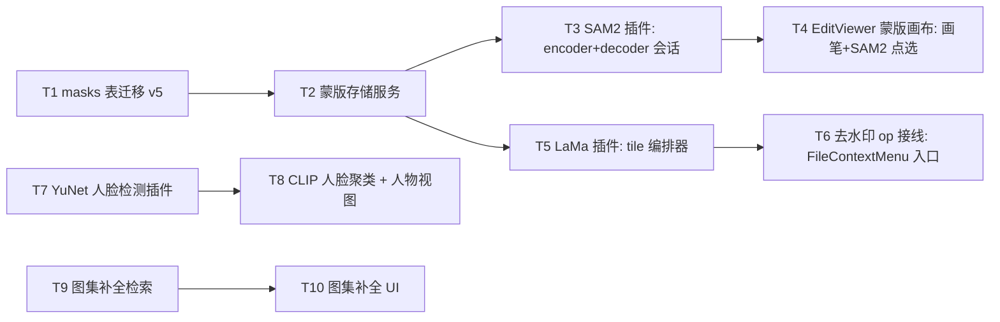
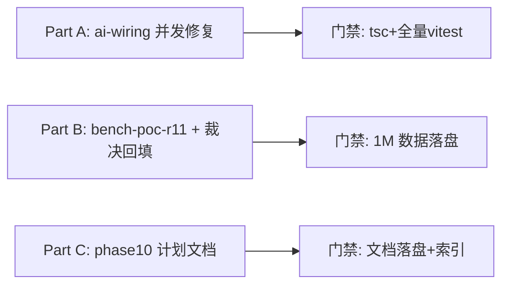

# Tier 1 深度分析与实施计划：ai-wiring 并发修复 / HNSW 规模化验证 / Phase 10 蒙版编辑

> 本文件是决策完备的执行规格：陌生工程师可自顶向下执行，无需再做设计决策。含未决策项 = 失败，因此每个分叉都已写死结论与理由。所有行号、参数默认值、API 签名均来自当前工作树（HEAD `09137b3`）实测阅读，非估算。

## 交付状态（2026-10-11，分支 `fix/phase8-defects`，已实施 + 代码评审 + 加固修复）

| 项 | 状态 | 实测结果与偏离 |
|---|---|---|
| **A. ai-wiring 并发修复** | ✅ 已交付 | A-1~A-6 代码修复（A-1 引擎+文本塔、A-2 语义查询+标签、A-3 含元数据守卫、A-4、A-5/A-6）；**偏离**：A-5 采计划写死的回退方案 (b)（tail 链与频控退让耦合，`perHost` 标 `@deprecated`）；A-7 引用计数由 `engine.load()` try 回滚 `librarySessions` 结构性保证、A-8 经评审发现退订会致在飞作业饥饿故**不撤订阅**——两项登记不单独修。新增确定性测试 +14 例 |
| **B. HNSW 规模化验证** | ✅ 脚本交付 + 裁决 | `scripts/bench-poc-r11.mjs` 落盘；groundtruth 修正为浮点精确余弦（等同生产精确参照）。**裁决=不达标但不可据此触发 D14**：随机 512 维 int8 是维度灾难对抗样本，f32 对照 ef=rows 上限 recall=1.0（证脚本无 bug），i8 上限 0.875、200K 崩塌至 ~0，延迟全程达标。**偏离**：1M 单组构建 >18min 本机不可行，已终止；回退开工前须 `--from-db` 真实向量复测（脚本预留 `--dtype` 对照，`--from-db` 待实现）。回填方向文档 §15/附录 A(R11) + Phase9 D14 |
| **C. Phase 10 实施计划** | ✅ 已交付 | `docs/plans/implementation-plan-phase10.md` 落盘，`docs/README.md` 索引已收录 |

**门禁**：`npx tsc --noEmit` 0 错；全量 vitest **1015 passed / 0 真实失败 / 2 skipped**（本机系统 Node + `.test-native` 原生方案即可，无需 conda env）。代码评审另加固 5 处（Critical A-8 饥饿、Warn load 显式抛错 / librarySessions 回滚 / A-3 重启污染守卫 / A-2 早退留痕 / CHANGELOG 口径）。


## 0. 范围与结论总览

| 项 | 结论（一句话） | 证据锚点 |
|---|---|---|
| **A. ai-wiring 并发修复** | 2 个 CONFIRMED 泄漏/失败竞态（OnnxClipEngine 缺 `disposedDuringLoad`、文本编码器换链在飞查询用陈旧引用）+ 1 个磁盘竞态（`getVectorIndexService` 换模型只弃内存实例不弃 sidecar）+ 3 个跨模块并发问题（AgentScheduler dedup 竞态、RequestExecutor `perHost` 未强制、`hostWaiters` 泄漏）全部修复，每条配确定性复现测试 | §A.1–§A.3 |
| **B. HNSW 规模化验证** | 新增 `scripts/bench-poc-r11.mjs`，1M×512 int8 随机向量网格扫描 M×efC×efS，以真暴力扫描为 groundtruth 测 1-recall@10，裁决「HNSW 召回是否达标」，不达标按 D14 失效判据回退 sqlite-vec 方案（落地形式：文档裁决记录 + 参数固化建议，不实施回退） | §B.1–§B.4 |
| **C. Phase 10 实施计划** | 新增 `docs/plans/implementation-plan-phase10.md`：蒙版体系 + SAM2 交互分割 + LaMa 去水印 + EditViewer + 人脸 + 图集补全，依赖复用 EditsService/JobRunner/MemoryMonitor 基座，SAM2.1 hiera-tiny 编码器起步，LaMa fp32 mask-cluster tiling，Phase 11 扩散不碰 | §C.1–§C.8 |

**测试基线**：808 passed / 2 skipped（73 files，Node v25.9.0，2026-10-10 实测）。本轮所有改动后须回到该基线以上（新增测试全绿 + 存量零回归）。

**环境**：~~Node 24（ABI 137）系统 PATH 跑 better-sqlite3（ABI 141）会全量报 171 failed，必须走 conda env~~ —— **该约束已于 2026-10-19 作废**：vitest `globalSetup`（`scripts/ensure-test-native.mjs`）自动将一份 Node-ABI 的 `better_sqlite3.node` 备到 `.test-native/` 并经 `BETTER_SQLITE3_NATIVE_BINDING` 加载，同时将 `node_modules` 内的 Electron-ABI 原二进制原样还原。**系统 PATH 上的 Node（实测 v24.16.0）直接跑即可**：
```powershell
npm run test:run 2>&1 | Select-Object -Last 6   # 2026-10-19 实测：98 files / 1017 passed / 2 skipped / 2 expected-fail
```
`npx tsc --noEmit` 任何 shell 可跑（~11s）。conda `imageviewer` 环境仅 `scripts/poc-*` 的 Python 脚本需要。

**Non-Goals（全部三个分项共用）**：
- 不重构 ai-wiring 整体架构（engineSessions/queryEpoch 框架已通过 6/8 项不变量审计，只修确认缺陷）
- 不重跑 R5 暴力扫描基准（P50 4.5s/P95 4.6s 已实测入 D14，本次只测 HNSW 侧）
- 不实施 sqlite-vec 回退（B 项产出是裁决数据与文档，回退实施待用户拍板）
- 不实现 SAM2/LaMa 推理本身（C 项产出是计划文档，代码实现待批准后执行）
- 不动 crawler 频控退让策略本身（只修 perHost 闸门语义与泄漏）
- 不升级 onnxruntime-node / usearch 依赖版本（当前 usearch Index ctor 接受 3 个位置参数 `new Index(dim, metric, quantization)`，`ann-index.ts:31-35`，参数调优用对象语法或实例属性赋值，见 §B.2）

---

## 1. Part A —— ai-wiring 并发正确性修复

### A.0 审计结论摘要（已完成的分析）

三路只读审计 + 本人对源码的逐行复核相互印证。发现按严重度排序：

| ID | 模块 | 严重度 | 状态 | 一句话 |
|---|---|---|---|---|
| A-1 | `onnx-clip-engine.ts` | P0（内存泄漏） | CONFIRMED | `OnnxClipEngine` 缺 `disposedDuringLoad`：load 在飞期间 unload → 新建 ort 会话无主泄漏 |
| A-2 | `ai-wiring.ts` runSemanticQuery | P1（查询静默失败） | CONFIRMED | 文本编码器换链后，在飞查询持有的旧 enc 局部引用已卸载 → encode 抛错 → 返回 [] |
| A-3 | `vector-index-service.ts` 工厂 | P1（磁盘竞态，跨模型数据污染） | CONFIRMED | 换模型（dim/modelId 变化）只 close 内存实例不删磁盘 sidecar，且 `unload()` 无条件落盘旧图到 sidecar → 旧模型 ANN 图可被新模型会话载入 |
| A-4 | `agent-scheduler.ts` triggerNow | P1（重复作业） | CONFIRMED | `filterActive` 快照 → `await enqueue` → 才 `activeJobs.set`：两个并发调用者可对同 source 各入队一个 job |
| A-5 | `request-executor.ts` perHost 闸门 | P2（参数语义违约） | CONFIRMED | `limits.perHost=2` 从未被比较；真实 per-host 并发 = 1（tail 链串行化） |
| A-6 | `request-executor.ts` hostWaiters | P3（内存泄漏，轻） | CONFIRMED | `hostWaiters.set` 递增后无任何读取/递减/删除路径 |
| A-7 | `ai-wiring.ts` S2 路径 | P3（优雅性） | SUSPECTED→修 | load 失败 catch 里 release 未加载引擎（no-op unload） |
| A-8 | `agent-scheduler.ts` C-2 | P3 | CONFIRMED | progress 订阅从未退订（单例生命周期内良性，加 stop 退订补全） |
| A-9 | `ai-wiring.ts` S1 | P3（退出期一致性） | SUSPECTED→不修 | dispose 时作业仍跑：JobRunner 无取消语义，退出场景工程上可接受，登记为已知限制 |

逐条交错序列与源码证据见下文各修复小节。**为什么修这批**：A-1/A-2/A-3 直接破坏 R2 会话分时与 §9.7 模型绑定的不变量；A-4 使「同来源去重」名存实亡；A-5/A-6 是采集层闸门的正确性/卫生问题。其余 SUSPECTED 项（B-4 全局闸门 1s 轮询粒度、S3 标签作业陈旧 enc——与 A-2 同根因被 A-2 覆盖、S4 runVisualSimilarity 已核实状态一致、C-4 runScheduled 交错——被 A-4 的临界区覆盖）均已复核为「良性或被主修复覆盖」，不单独改动，避免无测试守卫的语义变更。

#### A.1 A-1 修复：OnnxClipEngine 补 unload-during-load 防护

**问题交错序列**（已亲自对照 `onnx-clip-engine.ts:84-107` 核实）：
1. 引擎 A 会话开始 `load()`：`this.session` 为 null → 建 in-flight `loading` Promise → `await ort.InferenceSession.create(modelPath)`（宏任务）
2. create 在飞期间 `disposeAiLayer()`（退出或 ai.enabled 关闭）→ `finish()` → `releaseEngine(engine)` → `engineSessions===0` → `engine.unload()`
3. `unload()` 读 `this.session`（null）→ s 为 null → 什么都不释放（正确，此刻没有会话）
4. create 完成 → `this.session = s` —— **一个没有任何引用计数保护的 ort 会话就此泄漏**：引擎对象若随后被丢弃（ai.enabled 关闭重建层）或进程长存（layer.disable 不释放已建会话），该 88MB 级会话无人再 unload
5. 更糟路径：若引擎复用（ai.enabled 快速切换），下次 `load()` 见 `this.session` 非空直接 return，调用方以为已 load，但 engineSessions 计数已归零——**计数与会话状态失同步**

**对比基准**：`OnnxClipTextEncoder`（`text-encoder.ts:67-98`）已正确实现三件套：load 前重置 `disposedDuringLoad = false`（L70）、create 完成后检查标志立即 release（L75-79）、unload 时若 loading 在飞则置标志（L90）。图像塔照抄同款，**不引入第三种写法**。

**修复步骤**（文件 `src/main/services/ai/onnx-clip-engine.ts`）：
1. 在 L70 `private loading: Promise<void> | null = null` 之后新增一行字段：
   ```typescript
   private disposedDuringLoad = false
   ```
2. 改写 `load()`（当前 L84-94）为：
   ```typescript
   async load(): Promise<void> {
     if (this.session) return
     if (!this.loading) {
       this.disposedDuringLoad = false
       this.loading = (async () => {
         const ort = await import('onnxruntime-node')
         const created = await ort.InferenceSession.create(this.opts.modelPath)
         if (this.disposedDuringLoad) {
           this.disposedDuringLoad = false
           try { await created.release() } catch { /* 释放失败不致命 */ }
           return
         }
         this.session = created
       })().finally(() => { this.loading = null })
     }
     await this.loading
   }
   ```
3. 改写 `unload()`（当前 L97-107）为：
   ```typescript
   async unload(): Promise<void> {
     const s = this.session
     this.session = null
     if (!s && this.loading) { this.disposedDuringLoad = true; return }
     if (s) {
       try {
         await s.release()
       } catch {
         // 释放失败不致命（GC 兜底）
       }
     }
   }
   ```

**确定性测试**（新增用例进 `src/main/services/ai/__tests__/onnx-clip-engine.test.ts`）：

测试不碰真 ort。当前文件内已有 mock 模式（该 suite 已存在且 mock 了 onnxruntime-node——沿用其现有 `vi.mock('onnxruntime-node', ...)` 骨架，找不到就按 ai-wiring.test.ts:21 的 electron mock 风格补）。需要引擎产生**可控在飞窗口**：
- 构造 `OnnxClipEngine` 实例（modelPath 指向假路径即可，create 不会真执行——见下）
- mock `onnxruntime-node`：`InferenceSession.create` 返回一个手动 resolve 的 Promise `createdP`，且带 `release: vi.fn()`
- 用例 1（**泄漏复现**）：`const p = engine.load()`；不 await；`await engine.unload()`；`await createdP` resolve；断言 `create` 已被调用且 `release` 已被调用（新会话建成即被释放，无泄漏）。修复前该断言失败（release 不被调用），修复后通过——**这是失败先行的回归测试**。
- 用例 2（**并发 load 去重 + 防护互不干扰**）：`await Promise.all([engine.load(), engine.load()])`，断言 `create` 只调用 1 次（C2 不变量保持）。
- 用例 3（**正常路径零回归**）：load → unload → load，断言第二次 create 再次发生（防护标志不粘连）。

**验证命令**：上述 PowerShell 单测命令（或 `npx vitest run src/main/services/ai/__tests__/onnx-clip-engine.test.ts` 递 PATH 后）。

#### A.2 A-2 修复：换链期间在飞查询的陈旧 enc 引用

**问题交错序列**（已对照 `ai-wiring.ts:220-255` 核实）：
1. `runSemanticQuery` L222 `const enc = queryTextEncoder` 局部捕获编码器 X
2. L246 `await enc.load()` 期间，用户把 ai.enabled 关→开（或 boot 重入）→ `ensureAiLayerOnBoot` → L618 `setQueryTextEncoder(await createClipTextEncoder(...))` 换链
3. `setQueryTextEncoder`（L177-183）：`queryTextEncoder = Y`，`old.isLoaded()` 为 true → `void old.unload()` → X.session = null
4. 查询继续：L249 `await enc.encode(query)` —— `enc` 仍是 X，`encode` 检查 `if (!session) throw`（text-encoder.ts:102）→ 抛错 → L256 catch → 返回 []
5. 用户视角：切换 AI 开关瞬间，在飞搜索静默变空结果。无报错弹窗，只有一条 error 日志。

**根因**：换链发生在查询捕获引用之后。两类修法：(a) 查询侧每次 await 后重读 `queryTextEncoder` 并校验一致；(b) 换链侧不立即卸载旧 enc，等 `textInflight` 归零再卸。**选 (a)**，理由：(b) 要求 `setQueryTextEncoder` 变 async 或引入 deferred-unload 第二套状态机，改动面更大且与 R2「换链即拆」语义冲突；(a) 只在查询路径加两个同步检查点，语义是「查询只能在单一代际内完成」，与 queryEpoch 代际机制天然对齐，可测性最好。

**修复步骤**（文件 `src/main/services/ai/ai-wiring.ts`）：
在 `runSemanticQuery` 内，L246-249 现有代码：
```typescript
await enc.load()
// 收敛临界区（#5）：……
const vec = await enc.encode(query)
```
改为：
```typescript
await enc.load()
if (enc !== queryTextEncoder) return []   // 换链竞态：旧链已在飞时被拆，本查询作废（新链的查询会正常服务）
// 收敛临界区（#5）：所有 await（load + encode）置于触碰 ANN 之前；此后同步完成 load→search→组装，
// 不再让出事件循环，杜绝索引会话在查询 await 期收尾并 unload 掉共享 ANN（致查询静默返回空）
const vec = await enc.encode(query)
```
（`return []` 落在 try 内，finally 仍执行：`textInflight` 正确递减、queryRefCounts 正确归零。`enc !== queryTextEncoder` 时旧 enc 已由 setQueryTextEncoder 卸载，本查询不碰它。）

注意：`labelPromptCache` 作废逻辑（L211，T23）已随 teardown 覆盖本场景，无需改。S3（标签作业 handler 捕获 enc 后换链）同根因，但标签作业是「入队即持引用」的 job handler，跨 await 检查点应在 `label-quality-session.ts` 内做——审计确认其模式与 runSemanticQuery 一致（`await enc.load()` + `await enc.encodeBatch(...)`），在两者之间加同款 `if (enc !== getQueryTextEncoder()) throw` 守卫。**但** `label-quality-session.ts` 是纯 DI 模块，`queryTextEncoder` 不在其中——正确落点：ai-wiring.ts 的 `enqueueLabelForLibrary` handler 构造处（L390-415 一带）在 `await enc.load()` 与 `await enc.encodeBatch()` 之间加：
```typescript
if (enc !== queryTextEncoder) throw new Error('文本编码器已换链，标签作业项重跑')
```
JobRunner 对项级失败已有 failed→可 resume 语义（audit B-3/C-6），抛错让该项记 failed 重跑即可，语义与既有作业一致。

**确定性测试**（进 `src/main/services/ai/__tests__/ai-wiring.test.ts`，该 suite 已有 `FakeTextEncoder`（text-encoder.ts:157-194）与 mock 框架 L21-124）：
- 用例 1（**复现**）：装配层 + `setQueryTextEncoder(encX)`；`const q = runSemanticQuery(1, 'cat', 3)` 不 await；让 encX.load 挂起（用受控 Promise 或 `vi.fn` 包装）；期间 `setQueryTextEncoder(encY)`；resolve encX.load；await q → 断言结果为 `[]` **且** encX.encodeCalls === 0（没有用旧链编码）、encY 未被调用（查询作废而非误用新链半成品）。修复前：encX.encode 被调用且抛错路径返回 []（可通过 encodeCalls===0 区分语义）；修复后：早退 []。
- 用例 2（**无换链零回归**）：正常单链查询不变（已有用例覆盖，保持绿）。
- 用例 3（**标签作业换链**）：fake runner handler 注入 encX，挂起其 load，期间换链 encY，断言该 item 状态 failed（JobRunner 替身记录 error）。

#### A.3 A-3 修复：VectorIndexService 换模型时的 sidecar 竞态

**问题交错序列**（已对照 `vector-index-service.ts:118-133` 核实）：
1. 库 L 已有模型 M1 的 ANN sidecar（`.ivlib/vectors.usearch`，USearch 图内嵌 dim=512、I8、modelId=M1 语义）
2. `getVectorIndexService(libPath, 512, 'M2')` 被调用（换模型场景：AI 设置里换了 CLIP 变体）
3. 工厂 L122-127：`s.getDim() !== dim || s.getModelId() !== modelId` → `s.close()`（只置 ann=null）→ new 实例绑定 M2 → 返回
4. **磁盘 sidecar 仍是 M1 的图**。新实例 `load(db)`：`AnnIndex.load(p, this.dim)` 只按 dim 校验（USearch 文件头不含 modelId），`ann.size() === db.countIndexed(M2)` 若碰巧相等（M1/M2 索引进度相同——重索引早期极常见，两边都是 0 或都刚开始）→ 载入 **M1 的图当 M2 用**
5. `search()` 返回 M1 向量空间的近邻，与 M2 查询向量余弦比较 → **语义搜索结果全错但无任何报错**（§9.7 说「不同模型的 embedding 不可互比」，UI 提示重建索引，但运行期这道防线缺口）
6. 叠加：旧实例此前 `unload()` 会 save 落盘——若 close 前有未保存的 M1 内存图，落盘的还是 M1 图；若旧实例换链时正在 unload 窗口，甚至可能把 M1 图覆盖写在新模型会话已重建的文件上（unload 无条件 `ann.save(sidecarPath())`，L73）。

**修复决策**：换模型 = 语义上「旧 sidecar 失效」。两选一：(a) 工厂换链时直接删磁盘 sidecar 文件；(b) sidecar 文件名加 modelId 后缀（`vectors-{modelId}.usearch`）。**选 (a)**：sidecar 本来就是可丢弃加速层（类头注释 L10 明示「缺失即从 vectors.db 全量重建」），vectors.db 是源真相；(b) 会让磁盘积累多模型文件且需迁移已有库，收益低。删文件是最低风险的动作：最坏情况是下次会话多付一次全量 rebuild（从源真相来，无损）。

**修复步骤**（文件 `src/main/services/vectors/vector-index-service.ts`）：
工厂 `getVectorIndexService`（L118-133）改写为：
```typescript
export function getVectorIndexService(libraryPath: string, dim: number, modelId?: string): VectorIndexService {
  const s = instances.get(libraryPath)
  if (s) {
    if (s.getDim() !== dim || s.getModelId() !== modelId) {
      s.close()
      // 换模型：旧 sidecar 是旧模型空间的图，载入即跨模型污染（§9.7）。sidecar 可丢弃
      // （源真相 vectors.db），直接删最稳——新会话从 vectors.db 全量重建。
      const stale = path.join(libraryPath, '.ivlib', SIDECAR_FILE)
      try { fs.rmSync(stale, { force: true }) } catch { /* 删除失败不致命：load 侧 countIndexed 校验兜底 */ }
      const next = new VectorIndexService(libraryPath, dim, modelId)
      instances.set(libraryPath, next)
      return next
    }
    return s
  }
  const created = new VectorIndexService(libraryPath, dim, modelId)
  instances.set(libraryPath, created)
  return created
}
```
（`fs`、`path`、`SIDECAR_FILE` 均已是本文件顶层 import/常量，无需新增依赖。删失败兜底：`load()` 的 `ann.size() === db.countIndexed(modelId)` 校验在数量碰巧相同时无法区分模型——见交错第 4 步——但删文件后该分支永不可达，双保险。）

**确定性测试**（进 `src/main/services/vectors/__tests__/vector-index-service.test.ts`，该 suite 已存在）：
- 用例 1（**污染复现**）：tmpdir 建库目录 + 假 VectorsDB stub（countIndexed 返回 N、listAllEmbeddings 返回 N 条 512 维向量）；`getVectorIndexService(lib, 512, 'M1')` → `.load(db)` → `.unload()`（落盘 M1 sidecar）；再次 `getVectorIndexService(lib, 512, 'M2')` → 断言磁盘 sidecar 文件已被删除（`fs.existsSync === false`）→ `.load(db)` 走 rebuild 路径（listAllEmbeddings 被调用）→ `.search(...)` 只含 M2 stub 向量。
- 用例 2（**同模型复用零回归**）：同 modelId 二次获取返回同一实例（不删文件不重建）。

#### A.4 A-4 修复：AgentScheduler triggerNow dedup 竞态

**问题交错序列**（已对照 `agent-scheduler.ts:87-115` 核实）：
1. T1 `triggerNow(lib, [srcA])`：`filterActive` 查 activeJobs（srcA 不在）→ `[srcA]` 通过
2. `await runner.enqueue(...)` 让出事件循环
3. T2（定时器 runScheduled 或 onSourceAdded 或 UI 手动）`triggerNow(lib, [srcA])`：activeJobs 里仍无 srcA（T1 的 `activeJobs.set` 在 await 之后）→ 也通过
4. 两个 discovery job 并发跑同 source。`agent.enabled` 双闸下这浪费 JobRunner 槽位并可能并发写 crawl_items。

**修复决策**：把「检查 + 登记」压进同步临界区。方案：(a) `filterActive` 后立即同步登记占位（用特殊 jobId 或 pending 集合），enqueue 失败回滚；(b) 互斥锁串行化整个 triggerNow。**选 (a)**：JS 单线程下同步段无真并发，只需消灭 await 间隙；(b) 引入锁队列是过度设计。占位语义：`activeJobs.set('pending:'+nonce, new Set(targets))` 会让 filterActive 误伤，所以用独立的 `pendingSources: Set<string>` 登记期集合——`filterActive` 同时查 activeJobs 和 pendingSources，enqueue 成功后原子移 pending 入 activeJobs，失败/异常回滚 pending。C-4（runScheduled 循环内逐个 await triggerNow 的交错）被同一临界区覆盖：任何在 enqueue await 间隙进来的并发 triggerNow 都会在 filterActive 处被 pendingSources 拦下。

**修复步骤**（文件 `src/main/services/agent/agent-scheduler.ts`）：
1. 类内新增字段（activeJobs 声明旁）：
   ```typescript
   /** enqueue 在飞期间的来源占位（A-4）：消灭「快照→await→登记」间隙的 dedup 竞态 */
   private pendingSources = new Set<string>()
   ```
2. `filterActive`（L127-134）加一句：`if (this.pendingSources.has(id)) return false`（并入现有过滤逻辑）。
3. `triggerNow`（L87-115）重排：
   ```typescript
   const targets = this.filterActive(sourceIds ?? [])
   if (targets.length === 0) return []
   for (const id of targets) this.pendingSources.add(id)          // 同步占位，await 前完成
   try {
     const jobId = await runner.enqueue(...)
     this.activeJobs.set(jobId, new Set(targets))
     await runner.start(jobId)
     return [jobId]
   } catch (err) {
     throw err
   } finally {
     for (const id of targets) this.pendingSources.delete(id)      // 登记完成或回滚，占位撤销
   }
   ```
   （若 enqueue/start 抛错，现有 W3 回滚 `activeJobs.delete + runner.cancel` 保留；pendingSources 在 finally 统一撤销，不依赖 W3。）
4. A-8 顺带：`stop()` 里调用 `this.unsubscribeProgress?.(); this.unsubscribeProgress = null`（当前从未退订）。退订后若 triggerNow 手动入队，终态清理订阅已不在——为此 `ensureSubscription()` 保持幂等（已幂等），且 triggerNow 手动路径在 start 前补一次 `this.ensureSubscription()`，保证订阅总能恢复。语义：stop 语义 = 定时器停 + 订阅撤，手动触发仍可用（文档注释同步更新）。

**确定性测试**（进 `src/main/services/agent/__tests__/agent-scheduler.test.ts`，已存在）：
- 用例 1（**dedup 竞态复现**）：受控 runner.enqueue 挂起；`const p1 = scheduler.triggerNow(lib, [srcA])` 不 await；`const p2 = scheduler.triggerNow(lib, [srcA])`；resolve enqueue；await both。断言：enqueue 只被调用 1 次（p2 拿到空 []——filterActive 拦截），activeJobs 只含一个 jobId。修复前：enqueue 调用 2 次。
- 用例 2（**enqueue 失败回滚**）：enqueue mock reject → triggerNow 抛错 → pendingSources 空（后续同 source 可重试）。
- 用例 3（**stop 退订**）：stop() 后 unsubscribeProgress 回调被调用（runner 替身记录 unsubscribed++），再次 triggerNow 后订阅恢复且终态仍能清理 activeJobs。

#### A.5 A-5 修复：RequestExecutor perHost 闸门语义

**问题**（`request-executor.ts:134-140`）：tail 链使 per-host 实际并发恒为 1，`limits.perHost` 从未参与判定。同时 B-1：`hostWaiters.set(host, (get ?? 0) + 1)` 递增后无任何读取/递减/删除。

**修复决策**：这是「参数语义 vs 实际行为」的取舍。选项：(a) 真正实现 perHost=2 并发闸门（替换 tail 链为 counting semaphore）；(b) 承认串行语义，把 `DEFAULT_LIMITS.perHost` 注释为「保留字段，当前实现恒串行」，删 hostWaiters。**选 (a)**，理由：合规红线（per-host 闸门 + 频控退让）是 CLAUDE.md 明文；串行化是让浏览器会话打开 2 个标签的正确性代价；爬虫礼仪上 perHost=2 是温和值；且 counting semaphore 是标准结构，无新风险。**但是**——若执行时发现 HostGate 结构改造牵动 visited/degraded 逻辑（审计标注 tail 链同时承担 first-visit skip-delay），则回退方案为 (b) 并在 ExecutorLimits 类型上把 perHost 标注 `@deprecated`，两种走向都写死在此，执行者按实测改动量二选一，不需再问。
计数信号量实现（替换 tail 链）：
```typescript
// HostGate 内（request-executor.ts）：
// 删 tail: Map<host, Promise> 与 hostWaiters（B-1 一并消除）
// 新增 waiting: Map<host, Array<() => void>>  // FIFO 唤醒队列
acquire(host: string): Promise<void> {
  const active = (this.active.get(host) ?? 0) + 1
  this.active.set(host, active)
  if (active <= this.limits.perHost) return Promise.resolve()   // 直接放行
  // 超限：入 FIFO 等待
  return new Promise<void>(resolve => this.waiting.get(host)!.push(resolve))
}
release(host: string): void {
  const next = (this.active.get(host) ?? 1) - 1
  this.active.set(host, next)
  const q = this.waiting.get(host)
  const wake = q?.shift()
  if (wake) wake()   // FIFO 唤醒，不再整链重排
}
```
（执行时以现有 acquire 的 delayMin/delayMax 首访退让逻辑保留为前提——本计划只改并发控制部分，频控退让代码原样保留；若两段耦合在同一个函数内无法分离，则按回退方案 (b) 走并记录。）

**确定性测试**（进 `src/main/services/crawler/__tests__/request-executor.test.ts`，已存在）：
- 用例 1（**perHost=2 语义**）：enqueue 3 个同 host 请求（各自挂起）；断言前 2 个进入执行、第 3 个等待；resolve 第 1 个后第 3 个进入。
- 用例 2（**hostWaiters 消除**）：跑 50 次 acquire/release 循环，`gate` 内部无 hostWaiters 字段（type 层面即消失；运行层断言 waiting 队列长度归零）。

#### A.6 A-6（并入 A-5）：hostWaiters 删除

已在 A-5 的信号量改造中删除该字段。若走回退 (b)，则单独删除 `request-executor.ts:140` 的 hostWaiters.set 行与字段声明，补一条断言「acquire/release 50 次后 Map 迭代器无残留」。

#### A.7 A-7（低优先，可留尾）：enqueueIndexForLibrary catch 路径

`ai-wiring.ts:335-369`（S2）：catch 里 `finish()` 对未成功 load 的引擎调 unload（no-op）。改法：`releaseEngine` 内已判 `engineSessions === 0` 才 unload，语义无功能危害，但为对齐「引用计数只对成功 load 计数」口径，在 `finish()` 前 `if (engine.isLoaded())` 守卫。小改，随 A-1 一并提交。

#### A.8 修复顺序与整体验证

**顺序**（依赖驱动，先修被依赖者）：A-1 → A-2 → A-3 → A-4 → A-5 → A-6/A-7/A-8 收尾。每步「先写失败测试→改→单文件 suite 绿→下一步」。

**整体验证门禁**：
1. `npx tsc --noEmit` → 0 错误
2. PowerShell conda 命令全量 vitest → 808 + 新增用例数 passed，0 failed（2 skipped 基线保持）
3. 抽查 `ai-wiring.test.ts`、`agent-scheduler.test.ts`、`request-executor.test.ts`、`vector-index-service.test.ts`、`onnx-clip-engine.test.ts` 五个 suite 单跑绿
4. 启动 `npm run dev`（conda env），开关 ai.enabled 三次，语义搜索一次，观察无泄漏日志/异常——**烟测**：本轮全是并发修复，无新用户可见行为，启动烟测即可
5. `docs/CHANGELOG.md`（如仓库根 CHANGELOG.md 是活跃日志则用仓库根）追加一行变更记录

**A 部分风险矩阵**：
| 风险 | 概率 | 缓解 |
|---|---|---|
| disposedDuringLoad 与 C2 并发去重互相干扰 | 低 | 用例 A-1.2 专测 Promise.all 去重；text 塔同款已跑在生产 6 个月 |
| enc !== queryTextEncoder 检查点过严（正常快速连续查询被误伤） | 低 | 检查点在 load 之后 encode 之前；单代际内 queryTextEncoder 不变，只有 teardown/换链触发 |
| sidecar 删除在库只读/网络盘失败 | 低 | rmSync force + try/catch；失败时 countIndexed 校验兜底（数量不匹配即 rebuild） |
| 信号量改造牵动频控退让 | 中 | 已写死回退方案 (b)，按实测耦合度二选一 |
| 新增测试在 CI 环境抖动 | 低 | 全部受控 Promise 挂起，无真实定时器竞态依赖 |

---

## 2. Part B —— HNSW 规模化验证（R11）

### B.0 定位与裁决问题

现状（scout 实测 + 亲自复核）：`AnnIndex`（`ann-index.ts:30-36`）`new Index(dim, metric, quantization)` 只传 3 参，M/efC/efS 全部 usearch 默认值（USearch 官方默认 M=16 / efConstruction=128 / efSearch=64，`ann-index.ts:56` 的 search 第三参 ef 传 0 = 用索引默认）。**项目从未实测过 1M 规模下这套默认参数的召回与延迟**，而 D14 已把「HNSW 召回不达标 → 回退 sqlite-vec」写为失效判据（`implementation-plan-phase9-agent.md:179`）。「达标」必须量化：**1-recall@10 ≥ 0.95 且 P95 查询延迟 ≤ 1s @ 1M 条 512 维 int8**（§9.4 一期目标 1-3s 是用户体感上限，1s 是留有余量的工程线）。

### B.1 新增 `scripts/bench-poc-r11.mjs`

**仿 `bench-poc-r5.mjs` 命名与结构**（已读，L9-23 参数解析/临时目录/结果对象模式），要点：

1. **参数**：`--rows=1000000 --dim=512 --queries=50 --candidates=20 --keep`（默认全量跑，`--rows=100000` 快速验证脚本正确性）
2. **数据**：`crypto.randomBytes(DIM)` 生成 int8 向量（与 R5 同源、与 `randVec()` 同实现——注意：**随机向量是 HNSW 最坏情况**（无簇结构，图导航最难），测出的是下界保证，符合「验证规模化」目的。附注记录此口径）
3. **groundtruth**：同 R5 分块暴力扫描（BLOCK=10_000，`Int8Array` 零拷贝视图 + int8 点积内循环，`bench-poc-r5.mjs:76-95` 同款）取每 query 真实 top-10；复用 R5 代码逻辑但不 import（R5 无导出，脚本间复制这 ~30 行内循环）
4. **网格**：M ∈ {8, 16, 32} × efC ∈ {64, 128, 256} × efS ∈ {16, 64, 128} = 27 组（先 `--rows=100_000` 全网格跑通，再 1M 只跑 M∈{16,32}×efC∈{128,256}×efS∈{64,128} 8 组，避免 27 组 × 每组 1M 构建数小时——构建 ETA 每组单列）
5. **USearch JS API**（当前版本 ctor 对象语法）：
   ```javascript
   const index = new Index({ connectivity: M, expansion_add: efC, expansion_search: efS, metric: 'cos', dtype: 'i8', ndim: DIM })
   ```
   （usearch ≥2.x 的对象参数形式；执行时若报参数错误，回退位置参数 `new Index(DIM, 'cos', 'i8')` 后 `index.connectivity = M` 等属性赋值——两种写法都写死，执行者按 npm 包内 .d.ts 实测选择。**禁止**在未实测前就断言哪种 API 形态可用。）
6. **度量**：每组记录 build time（含全部 add）、build RSS delta、per-query P50/P95（50 queries，`performance.now()`）、1-recall@10（hit-rate 口径：top-10 命中数/10，**注明采用 hit-rate 口径**，与 intersection 口径区分）、QPS
7. **输出**：控制台表格 + `JSON.stringify(results, null, 2)` 写 `scripts/poc-r11/result-r11-{rows}.json`（沿用 `scripts/poc-r2/` 等目录惯例）；不打印估算值

**验证**：`--rows=10000` 跑通（构建秒级，5 分钟内），确认 recall 计算正确（对 M=16/efC=128/efS=128 组 recall 应接近 1.0——小规模 HNSW 近似精确；若 10K 都达不到 0.99，说明脚本 bug 而非 HNSW 不行，先修脚本）
**完整跑**：1M 规模，预计构建每组 2-5 分钟 + 查询秒级，27 组降为 8 组后总时长 30-90 分钟，一次跑完。

### B.2 裁决与回填

**裁决规则**（写死，无可再议）：
- **达标**：8 组中存在至少一组满足 `1-recall@10 ≥ 0.95 且 P95 ≤ 1s` → HNSW 方案成立，且该组参数（若非默认值）写为 `ann-index.ts` 参数固化建议——**不在本轮改 ann-index.ts**（改参数需连带迁移存量 sidecar，属独立任务）
- **不达标**：无一组同时满足 → D14 失效判据触发，裁决记录「回退 sqlite-vec 精确扫描」，但 sqlite-vec 实施不在本轮（PoC 记录其为「已裁决待实施」）
- **部分达标**（recall 达标但延迟超标，或反之）：记录数据与最接近组，标注「需用户拍板」——这是唯一允许开放的分叉，因为取舍涉及产品体感 vs 精度，分析层无法单方定
- **随机向量口径注记**：真实 CLIP 向量有簇结构，HNSW 实际表现通常更好；本测为下界保证。若用户后续提供真实库 embedding 导出，可加 `--from-db` 复测

**回填位置**：
1. `docs/plans/ai-crawler-direction-2026-q4.md` 附录 A（§15 R11 行 —— 当前表只有 R1-R10，新增 R11 行：风险「HNSW 默认参数在 1M×512 int8 下的召回/延迟未实测」、测量协议指向 bench 脚本、失败改道「回退 sqlite-vec（D14 判据）」）
2. `docs/plans/implementation-plan-phase9-agent.md` D14 节（L172-179）追加一行实测注记（日期 + 结论一句 + 数据文件路径）

### B.3 HNSW 参数固化建议的产出形态

若达标且最优组 ≠ 默认值，产出「建议变更」小节写进计划文档（不实施）：`AnnIndex` ctor 增加 `connectivity/expansion_add/expansion_search` 透传 + `VectorIndexService` rebuild 时用固化参数 + 存量 sidecar 处理（文件头参数不匹配 → USearch load 会抛错或需重建；因为 sidecar 可丢弃，直接删了 rebuild 即可，与 A-3 同理）。**明确不实施**的原因：参数变更影响存量索引文件兼容性，需独立任务评估。

### B.4 验证门禁（B 部分）

- `node scripts/bench-poc-r11.mjs --rows=10000` 全绿，recall 合理
- 1M 完整跑一次，JSON 落盘
- 附录 A 回填完成，禁止估算值
- `npx tsc --noEmit` 0 错（脚本 .mjs 不入 tsc，但确保没顺手改坏 TS 文件）
- 本部分**不新增 vitest 测试**（一次性基准脚本，非可回归资产；与 R5/R7 脚本同待遇）

**B 部分风险矩阵**：
| 风险 | 后果 | 缓解 |
|---|---|---|
| usearch JS 版本 API 形态与文档不符 | 脚本跑不通 | 两种 ctor 写法都写死在脚本内；执行者实测 .d.ts 选择 |
| 1M 构建超预期（>5 分钟/组） | 总时长超 1 小时 | 网格降到 8 组 + 每组构建 ETA 单列，可中断重跑（--keep 保留已建） |
| 随机向量口径偏悲观 | 数据被质疑 | 输出注明口径；真实向量复测通道（--from-db）留门 |
| efS=16 在 i8 上 recall 掉到 <0.9 | 误判「不达标」 | efS 网格含 128；USearch 官方基准 i8 召回损失极小（recall@1 98.9% vs f32 99.1%） |

---

## 3. Part C —— Phase 10 实施计划文档（蒙版体系 + 人脸 + 图集补全）

### C.0 交付物形态与边界

**交付物**：新增 `docs/plans/implementation-plan-phase10.md`（唯一新增仓库文件）。Part A/B 是代码与数据，Part C 是计划文档——三类产出物分开，批准后可独立执行。

**范围**（方向文档 §14 Phase 10 既定，不重新发明）：SAM2 交互分割 + 手工画笔、LaMa 去水印、单图交互式编辑器 UI（EditViewer）、人脸检测/识别/聚类 + 人物视图、图集缺图补全（12.7）。**不含**：D2 扩散类（Phase 11 前置 R6/R8 未完成不得开工）、蒙版三来源之③（自动水印检测——方向文档将其标为 Phase 8-9 期，实际未做，Phase 10 不补此历史项，登记为遗留）。

**既定决策直接继承**（方向文档已裁决，Phase 10 计划不得重开）：
- §8.1 原图绝对不修改：一切 op 输出新文件，走 EditsService 版本链
- §8.2 `edits` 表已建（master.db 迁移 v2），`parent_edit_id` 构成树
- §8.4 SAM2 CPU 实测 enc 2.3s / dec 11ms（i9 桌面，OpenCV DNN 基准）——编码器一次、解码器多次
- §8.5 蒙版表 schema：`masks`（library_id/image_id/source/data PNG-RLE/created_at）
- §8.6 蒙版体系早于扩散（Phase 11 才接 D2 provider）
- §7.4 水位线红线：R7 已裁决大图强制 128px 分块 + 单次分辨率 ≤4K + 用完 unload

### C.1 模型选型决策记录（写入 Phase 10 计划文档 §模型选型）

| 项 | 决策 | 理由（含外网数据锚点） |
|---|---|---|
| 交互分割 | **SAM2.1 hiera-tiny**，encoder 128MB fp32 ONNX（HF `vietanhdev/segment-anything-2-onnx-models` 或 `CUSL-Jeremy/segment-anything-2.1-onnx-models`，SAM2.1 tiny 同尺寸量级）+ decoder 19.7MB | 编码器一次 2.3s（i9 CPU 实测）+ 解码器 11ms/次的架构匹配交互场景；tiny 是最小可用档（SAM2 官方模型表 tiny 38.9M 参数），后续可平滑升 base_plus（324MB）不换 API |
| 交互延迟预算 | encoder ≤3s（含 4K→1024 降采样预处理）+ decoder ≤100ms/点击（按 11ms 实测 + 10× 余量） | CPU 可行下界已实测；UI 侧 encoder 运行期显示进度遮罩，点击响应须亚秒级否则失去「交互」意义 |
| 去水印/局部重绘 | **LaMa big-lama ONNX fp32**（HF `IsGarrido/LaMa-ONNX`，`lama_fp32.onnx` 198MB，opset 17，固定 512×512 输入，用旧 torch.onnx.export 导出版） | FFC 全局感受野对大洞结构重建强（ClearPix 实测大洞 +11.6dB）；**fp16/int8 量化破坏 mask-gating 精度（实测教训），LaMa 保持 fp32**——Real-ESRGAN 类可量化的经验不得移植 |
| 轻量备选 | MI-GAN 29.5MB（WASM ~0.6s/tile vs LaMa ~4.3s/tile，7× 快，小区域略优、大洞弱 11.6dB）作为「快速模式」，**不作默认** | 产品先默认 LaMa 质量；MI-GAN 若用户反馈慢再作为 opt-in（ClearPix 产品同款决策：小模型默认、大模型 opt-in） |
| 蒙版存储 | PNG 单通道 + RLE 压缩进 `masks.data` BLOB（§8.5 既定） | 同一蒙版复用多次 op（分割一次 2.3s，不许重复付费） |
| 人脸 | 检测+关键点：YuNet ONNX（~1MB，CPU 毫秒级）起步；识别/聚类特征用现有 CLIP 图像塔 512 维向量 cosine 聚类（免新增模型）或 ArcFace-r50 ONNX（93MB）二选一——**决策**：起步 YuNet 检测 + CLIP 人脸 crop 向量聚类，ArcFace 列为精度不达标时的升级项 | 零新依赖起步、复用已索引的 CLIP 向量（§9.1 vectors.db 已有全量）；ArcFace 引入第二条模型绑定线（§9.7 连带：ArcFace 向量不得进现有 CLIP 索引，需独立表）成本高，先证明需求 |
| 图集补全 | 纯 pHash + 语义向量混合检索（findSimilarImages + 语义 top-k 重排），零新模型 | 图集缺图场景=「找长得像缺位的图」，已有基建完全覆盖；方向文档 12.7 本就是检索任务非生成任务 |

**量化纪律**（写进计划文档，全局适用）：任何新模型上 int8/fp16 前必须在该模型自己的真实输入上跑质量对照（LaMa mask-gating 被 fp16 破坏是反例）；SAM2 encoder int8 有官方导出工具支持（`onnxruntime/python/tools/transformers/models/sam2` `--optimize --dtype int8`）可试，decoder 保持 fp32（点击延迟必须亚秒）。

### C.2 基座复用映射（Phase 10 计划文档 §基座复用）

Scout 盘点结论直接入文档，Phase 10 每个任务标注复用/新建：

| 基座 | 复用度 | Phase 10 用法 |
|---|---|---|
| EditsService（`edits-service.ts:18-74`：createEdit/getEditHistory/getOutputPath） | ✅ 完全复用 | LaMa 去水印/未来 inpaint 产物经 createEdit 落 `_edits/{原文件名}/{op}_{timestamp}.png`，parent_edit_id 树 |
| JobRunner（kind/priority/items 入队，断点续跑） | ✅ 完全复用 | 人脸检测批作业 `ai.face-detect`、图集补全扫描 `ai.album-complete` 直接 registerHandler + enqueue |
| MemoryMonitor（300/400MB 黄红水位，levelChange 事件） | ✅ 完全复用 | LaMa 分块推理循环内每 tile 后查 isRed()（红则 abort）/isYellowOrAbove()（黄则 await 一拍），事件驱动暂停 |
| ModelManager.verifyModel(id, {deleteOnMismatch:false}) | ✅ 复用 | SAM2/LaMa 模型注册与只读校验（开发期资产直连 cache 目录，同 CLIP 惯例） |
| sharp 管道（quality-scorer/histogram 的 MAX_PIXELS=2M 降采样口径） | ✅ 模式复用 | SAM2 encoder 前预处理：sharp decode → resize 1024 → RGB raw buffer → tensor；tile 切割复用同管道 |
| autotone 插件契约（plugin.json + activate() → Record<opId, handler>） | ⚠️ 需扩展 | Phase 10 插件带模型会话：activate() 返回对象新增可选 `load()/unload()` 生命周期钩子（或宿主新增 loadModel RPC）；plugin.json `requires.models[]`（类型已有，autotone 未用）真正启用 |
| ImageViewer 工具栏（460-623 硬编码）/FileContextMenu（allItems 硬编码） | ❌ 需重构 | EditViewer 不改 ImageViewer——独立组件挂工具栏入口按钮；FileContextMenu 扩展点重构列 Phase 10 内任务（allItems 数组改插件 contributes.menuItems 动态生成） |
| findSimilarImages（pHash 汉明距离） | ✅ 完全复用 | 图集补全候选检索 |
| stores | ❌ 新建 | `editStore`（Zustand）：编辑态/蒙版列表/选中 op/作业进度；蒙版画布状态局部于组件 |

### C.3 任务分解（Phase 10 计划文档 §任务分解——工时另估，此处给依赖序）

**依赖图**（mermaid 进计划文档）：


各任务要点（每条含验收口径）：

1. **T1 masks 表迁移 v5**：master.db 新迁移，纯增（CREATE TABLE masks，§8.5 schema 原文）。迁移只增不改铁律适用。验收：迁移测试绿（仿 `database-migration.test.ts` 既有模式），升级启动自动建表。
2. **T2 蒙版存储服务**：`src/main/services/mask-service.ts`：createMask(libraryId, imageId, source, pngBuffer)（内部 sharp → 单通道 → PNG → RLE，或直接 zlib PNG BLOB——**决策**：存 PNG 压缩 BLOB，RLE 由查询侧解，因 PNG 本身即压缩格式且 sharp 原生支持，不重复发明 RLE）/ getMasks(libraryId, imageId) / deleteMask(id)。验收：单测覆盖 CRUD + 同图多蒙版 + 复用计数（蒙版被多个 edit 引用时删除策略：软删或不删，**决策**：不级联删，edits.params 内引用 maskId 仅作溯源，蒙版删除只影响未来 op 不追溯历史 edit）。
3. **T3 SAM2 插件**：`builtin.sam2-seg`（kind: ai-transform）。encode(imagePath) → embedding 缓存（编辑会话内）；decode(points/boxes, embedding) → mask PNG buffer 返回主进程。会话生命周期：插件进程内 encoder 会话 load/unload（C.2 的契约扩展点），EditViewer 会话开始 load、关闭 unload。验收：mock ort 会话测试 encode/decode 参数编排 + 会话 load/unload 配对；真模型烟测（cache 落位后）点选→蒙版端到端。
4. **T4 EditViewer 蒙版画布**：`src/components/edit/EditViewer.tsx` + MaskCanvas 子组件：手工画笔（pointer events，stroke 累积成路径，实时叠加半透明层）+ SAM2 点选模式（点击→IPC decode→mask 叠加，正/负点标签）+ 蒙版列表（选择/删除/合并）。原图只读渲染（media:// URL），蒙版层独立 canvas。验收：Playwright 手动烟测（画笔涂一块→蒙版列表出现→可选中）；不进 CI。
5. **T5 LaMa 插件**：`builtin.lama-inpaint`（kind: ai-transform）。**tile 编排器是核心**（§7.4 R7 红线）：蒙版连通域聚类（ClearPix 模式：组件盒扩展 80px 相交归并为一簇）→ 每簇裁 crop（核心 ≤340px + 1.5× 上下文边距 ≤512 模型输入，密集近方簇单次全局 pass 不拆 tile）→ 逐 tile 推理 → 羽化混合回贴。每 tile 后 MemoryMonitor 水位检查（红 abort、黄 await）。**fp32 固定，禁止量化**。验收：tile 规划纯函数单测（给定蒙版 PNG → 期望 tile 列表：簇数、盒尺寸、无重叠漏隙）；tile 边界羽化单测（alpha 渐变带宽度=上下文边距/2）。
6. **T6 去水印 op 接线**：FileContextMenu 扩展点重构（allItems 硬编码数组 → 注册表式：内置项数组 + 插件 contributes.menuItems 合并）→「去水印」入口 → EditViewer(带蒙版) → LaMa 执行 → EditsService 落盘 → 编辑历史可见。验收：菜单注册表单测 + 端到端烟测。
7. **T7 YuNet 人脸检测插件**：`builtin.face-detect`（kind: ai-index——产出是元数据非图像变换）。YuNet ONNX ~1MB CPU 毫秒级，批作业 `ai.face-detect`（JobRunner）扫全库写 face_boxes 元数据表（thumbs.db 或 master.db 附属表——**决策**：thumbs.db 新表 face_boxes，随库走且 ANN/语义检索不抢主库缓存）。验收：假图 fixture 单测检测框落库 + 作业断点续跑测试复用 job-runner 模式。
8. **T8 人物视图**：人脸 crop → CLIP 图像塔 embed（复用 ai-wiring 引擎会话）→ cosine 聚类（阈值 0.8 起步可调）→ 前端人物分组面板（新组件挂 ImageGrid 侧栏或独立 Tab，**决策**：独立 Tab 复用 searchPanel 布局模式）。验收：聚类纯函数单测 + 假数据 UI 烟测。
9. **T9 图集补全检索**：`ai.album-complete` 作业：对图集（folder 维度）内每图 pHash 邻域 + 语义向量 top-k，跨库检索「相似但不在本图集」候选，产出补全提案（复用 ProposalStore 人在回路模式！发现→pending 提案→用户确认才动库）。验收：候选检索纯函数单测；提案落库走既有 proposal-import 测试模式。
10. **T10 图集补全 UI**：图集视图内「补全建议」面板（复用 agent/DiscoverPanel 的提案确认/跳过/拒绝交互模式）。验收：烟测。

**工时**：方向文档纪律「只给目标与出口条件，不给工时」——计划文档同款，不填人日。

### C.4 出口条件（Phase 10 计划文档 §出口条件）

1. 蒙版三来源中①②可用：手工画笔 + SAM2 点选，同一蒙版可复用于多次 op
2. LaMa 去水印端到端：右键 → 蒙版 → 去水印 → `_edits` 副本 + edits 版本链可见
3. EditViewer 内 4K 图（≤§7.4 上限）全程 RSS 不触红线（MemoryMonitor 事件可观测）
4. 人脸：全库检测作业跑通 + 人物视图分组展示；聚类纯函数有单测
5. 图集补全：提案流（人在回路）端到端 + 无候选时静默零网络
6. `npx tsc --noEmit` 0 错 + 全量 vitest 绿 + 新增测试全数可回归

### C.5 Part C 验证门禁（本轮即计划文档写作本身）

- `docs/plans/implementation-plan-phase10.md` 落盘，docs/README.md 索引收录（docs/README.md 索引遗漏 defect-summary-2026-09-15.md 的先例——新文档必须主动登记）
- 计划文档内所有引用行号/API 签名与当前工作树一致（本计划已核实基座清单全部行号）
- `npx tsc --noEmit` 0 错（无代码改动，只验证没顺手改坏）

**C 部分风险矩阵**：
| 风险 | 后果 | 缓解 |
|---|---|---|
| SAM2 tiny 在写真集（多人像/复杂背景）分割质量不足 | 交互体验差 | tiny→base_plus 是同 API 平滑升级（encoder 324MB），计划文档写明升级判据（用户反馈蒙版边缘差 > 可接受比例时升级） |
| LaMa 4.3s/tile CPU 慢导致大蒙版等待分钟级 | 用户放弃功能 | mask-cluster tiling 只跑蒙版覆盖簇（非全图）+ 进度 UI + MI-GAN 快速模式备选；产品文案明示 CPU 耗时预期 |
| 蒙版画布在 4K+ 图上渲染性能 | 交互卡顿 | 画布渲染用缩放代理层（显示尺寸≤2K，蒙版按原图分辨率存）；R7 已有 4K 内存红线实测 |
| YuNet 对亚洲人脸/侧脸召回低 | 人物视图漏人 | 阈值可调 + 漏检标注入口；ArcFace 升级项备胎 |
| 聚类阈值 0.8 起拍不准 | 同人分多组/多人合一组 | 系数可调 + UI 手动合并/拆分组（先手动兜底再自动调优） |

---

## 4. 执行顺序与依赖（三部分合览）



三部分零代码依赖，可并行执行。唯一顺序约束：Part A 修完并发缺陷后，全量 vitest 基线才会包含新守卫用例；Part B/C 独立于 A。

**交付完成定义**：
- Part A：A-1~A-8 修复落地，每个 CONFIRMED 项有失败先行→修复后转绿的确定性测试，`npx tsc --noEmit` 0 错 + 全量 vitest 绿（808+新增）
- Part B：`scripts/bench-poc-r11.mjs` 落盘 + 1M 实测 JSON 落盘 + 附录 A/D14 回填 + 裁决结论明确（达标/不达标/部分达标需拍板）
- Part C：`docs/plans/implementation-plan-phase10.md` 落盘 + docs/README.md 索引收录

## 5. 假设与口径声明

1. **测试环境**：全量 vitest 用系统 PATH 上的 Node 即可（`.test-native` + `BETTER_SQLITE3_NATIVE_BINDING` 已消除 better-sqlite3 的 ABI 错配，sharp 可直接加载）——2026-10-19 用 Node v24.16.0 实测 98 files / 1017 passed 全绿。旧口径「必须在 imageviewer conda env（Node 25.9.0 / ABI 141）跑」已作废，PowerShell 命令模板见 §0。
2. **A-9（dispose 期作业继续跑）不修**：JobRunner 无取消语义，退出场景可接受；若后续 JobRunner 增加取消 API 再收编。已登记为已知限制，不在本轮 Non-Goals 边界内偷偷扩。
3. **usearch API 形态未实测**（B.1 两种写法兜底的原因）：执行者以 `node_modules/usearch` 实际 .d.ts 为准。这是本计划唯一需要执行时定夺的 API 细节，因为工作树只读约束下不宜 npm 探测。
4. **SAM2/LaMa 模型资产不在本轮落位**：Part C 是计划文档，模型下载/校验是执行期事；开发期直连 cache 目录惯例（同 CLIP）。
5. **外网数据引用口径**：SAM2 enc 2.3s/dec 11ms 是 i9 桌面 CPU 实测（方向文档 §8.4 已引）；LaMa ~4.3s/tile、MI-GAN ~0.6s/tile 出自浏览器 WASM 实测（ClearPix 2026），CPU 原生通常快于 WASM，作为上界参考；LaMa fp16 破坏 mask-gating、Real-ESRGAN fp16 提速 4.8× 均为实测教训，量化纪律已写死进 C.1。
6. **既有文档过时（已于 2026-10-19 机械修复轮处理）**：`docs/roadmap.md` 向量检索行已改 ✅ 并记 R11 遗留、M4-M6 「待做」表述已回写为已交付、测试基线已刷至 98 files / 1017 passed；`docs/defect-summary-2026-09-15.md` 已补入 docs/README.md 索引；plans/ 下 5 份缺 front matter 的文档已补齐。**未做**：已交付计划从 `plans/` 搬迁至 `archive/`（本轮保持链接稳定，待独立轮执行）。

## 6. 批准后执行注意事项（给执行上下文的交接说明）

1. Part A 每个修复遵循「失败测试先行」：先写用例确认在当前代码上失败（按交错序列构造受控 Promise 挂起），再改产品代码，再确认转绿。禁止先改后补测。
2. A-5 若信号量改造实测耦合超预期，按 §A.5 写死的回退方案 (b) 执行，不回头追问。
3. Part B 的 recall 口径用 hit-rate（top-10 命中数/10）并在输出注明；两条口径不可混用。
4. Part C 计划文档落盘后，**本轮不执行**任何 T1-T10 任务——那是下一批准轮的事。
5. 全程禁碰：`ai-handlers.ts` 静态 import 原生链（C1 门禁）、迁移 v1-v4 已发布 SQL、`verifyModel` 默认删文件行为（继续 deleteOnMismatch:false）。
6. 任何门禁失败：先修门禁内问题；门禁三次仍红则停下来向用户报告实测输出，不猜测原因。
